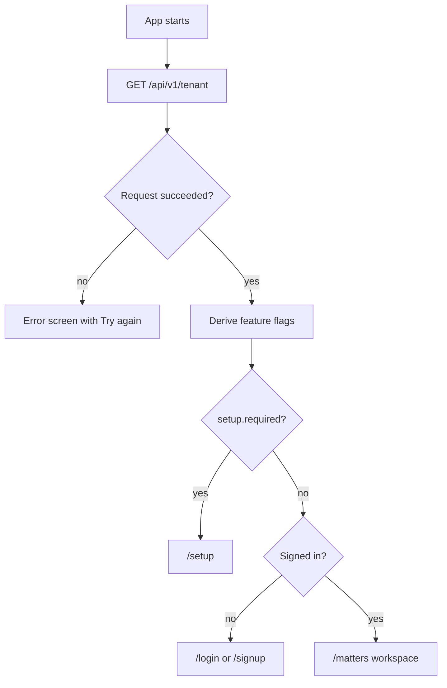
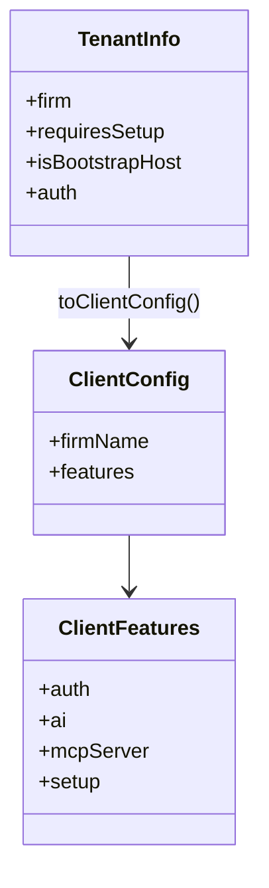

# Client configuration

The frontend has no feature env file. On boot, `ClientConfigProvider` calls
`GET /api/v1/tenant`, converts the response with `toClientConfig`, and exposes
`useClientConfig()` / `useAuthFeatures()`. A slow first load shows
`BootScreen`; a failure shows a retry card instead of a blank app.

## Flags and what they change

| Server field | Client flag | Visible effect |
| --- | --- | --- |
| `auth.allowSelfSignup` | `selfSignup` | Signup link and `/signup` form. Off shows "Contact your firm admin". |
| `auth.forceSso` | `passwordLogin=false`, `ssoRequired` | Password form hidden; `/login` starts in SSO mode; `/signup` explains SSO-only access. |
| `auth.ssoEnabled` | `ssoLogin` | SSO action appears. With both methods, the user can switch between email and SSO. |
| `auth.ssoEnabled && forceSso` | `ssoRequired` | Only SSO works; an email is still required to route the identity provider. |
| `auth.requireEmailVerification` | `emailVerification` | Signup success says "verify your email" instead of "account ready". |
| `auth.mailConfigured` | `mailConfigured` | Verification and reset copy can promise an email; otherwise the UI does not. |
| `auth.aiEnabled` | `ai.enabled` | Dep AI conversation and the AI settings status. Off leaves evidence tools usable. |
| `auth.mcpServerEnabled` | `mcpServer.enabled` | MCP settings surface. |
| `requiresSetup` | `setup.required` | Routes a signed-in user to `/setup`. |
| `isBootstrapHost` | `setup.bootstrapHost` | Explains that this host creates the first firm. |

## Important cases

### SSO required

`forceSso` plus `ssoEnabled` produces `passwordLogin=false` and
`ssoRequired=true`. The login page:

1. Hides the password field and the signup path.
2. Keeps an email field, because the SSO start call needs the address.
3. Shows a single "Continue with SSO" action.
4. Never offers a password form that the server would reject.

If `forceSso` is set without `ssoEnabled`, the tenant reports no usable login
method; that is an operator misconfiguration. The API still enforces it, and
the UI should not invent a fallback.

### Self-signup closed

The login page replaces the signup link with "Contact your firm admin". The
signup route still exists, but renders a closed state so a bookmarked URL does
not produce a form that always fails.

### AI disabled

The AI page and chat still open, but state that no model provider is
configured. Evidence search, facts, chronology, contradictions, and live line
storage do not depend on a model; only the answer/extraction step degrades.

### Mail not configured

Email verification copy is only shown when `mailConfigured` is true. A closed
mail transport must not tell the user to check an inbox that will never
receive a message.

The mapping lives in `src/lib/config/client-config.tsx`. Change a flag there,
not in individual pages, so every screen agrees.
