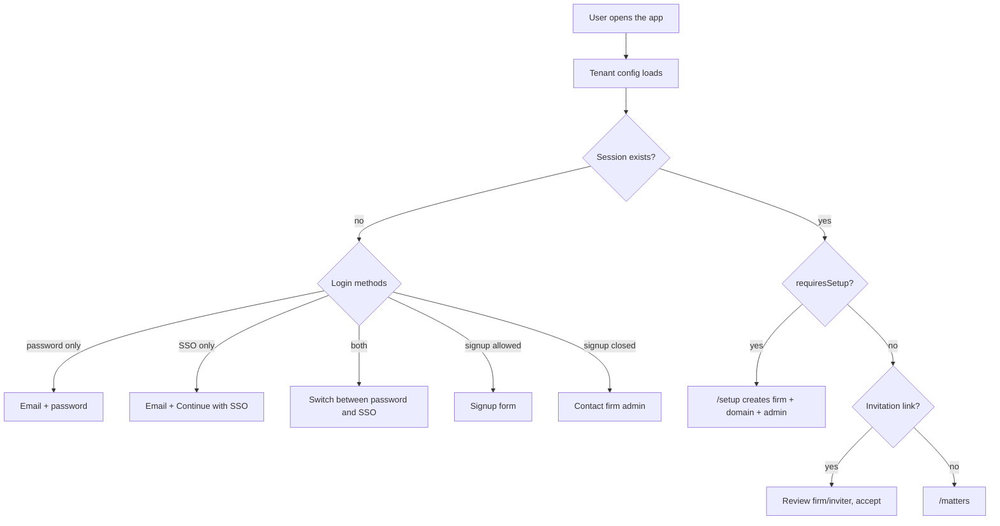
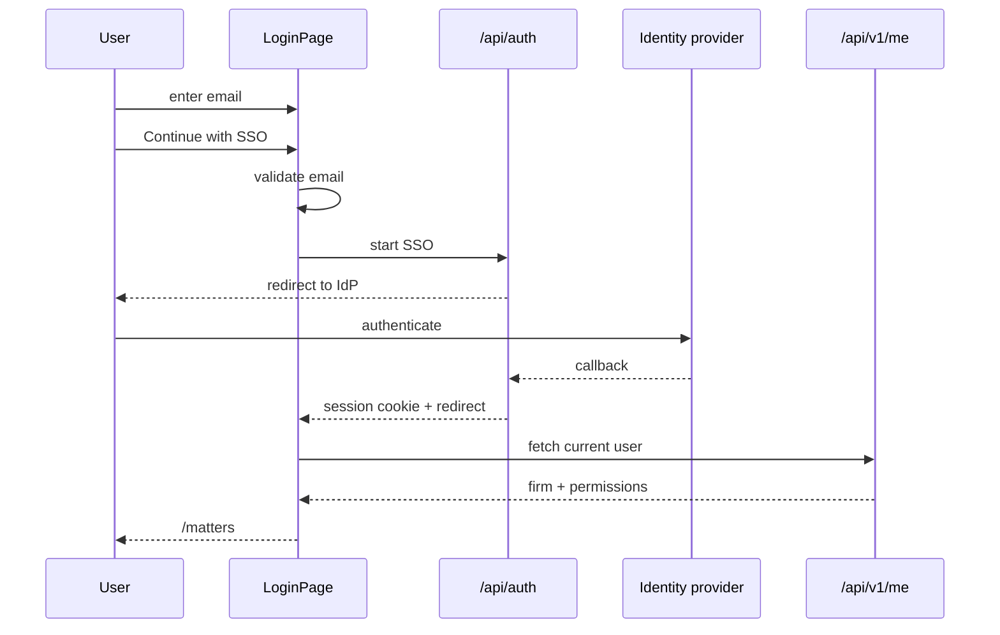

# Authentication UX

Guards decide which shell a visitor sees. `RequireGuest` keeps signed-in users
out of login/signup, `RequireSetup` sends a signed-in user to onboarding when
the host has no firm, and `RequireAuth` protects the workspace.

## Password login

1. User submits email and password.
2. The client calls Better Auth, then `GET /api/v1/me`.
3. The `me` response seeds the session query cache.
4. Redirect to `/setup`, the `returnTo` path, or `/matters`.

A failure keeps the form values and shows the server message. There is no
"forgot password" promise unless mail is configured.

## SSO login

SSO needs an email because the server routes the identity provider by domain.
The form validates the address locally, then redirects to the provider. A
failed start shows an inline error and re-enables the button.

## Invitations

`/invitations/:token` is public. It shows the firm name, inviter, role, and
expiry before the user accepts. Accepting creates the member and sends the user
to login or directly into the workspace when a session already exists. A used,
revoked, or expired token renders a clear terminal state, not a retry loop.

## First-run setup

On the bootstrap host with no firm, only setup and health routes work.
`SetupFirmPage` creates the first firm, its primary domain, and the owner. After
success it clears the tenant query and navigates to the workspace. If the firm
already exists, the setup route is no longer shown.

## Email verification

When required, signup ends in a "check your email" state. The user cannot sign
in before verification. The resend action is only shown when mail is
configured; otherwise the page explains that a firm admin must help.
