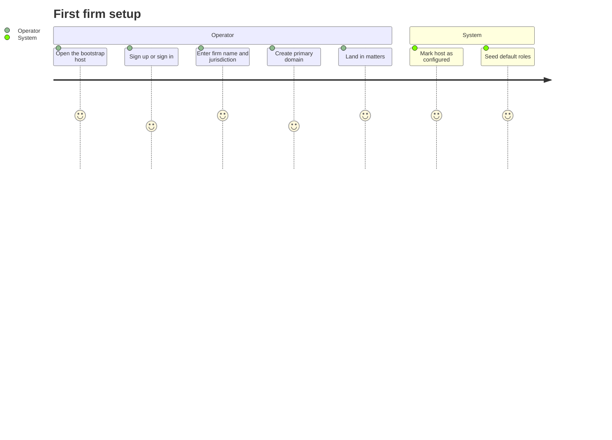
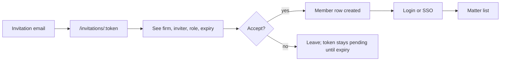
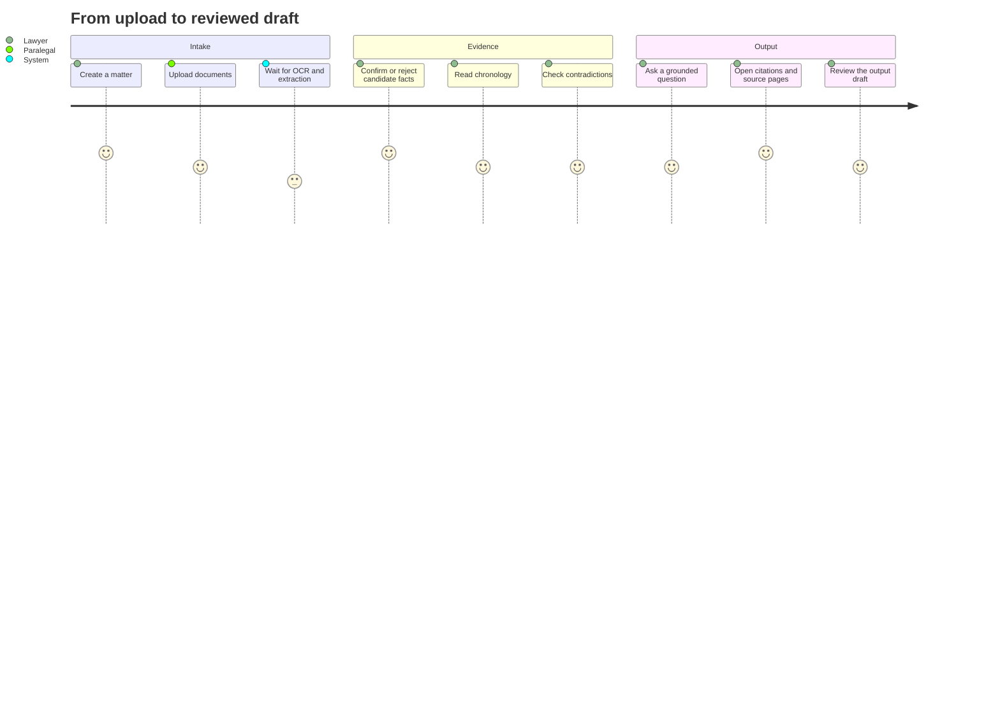
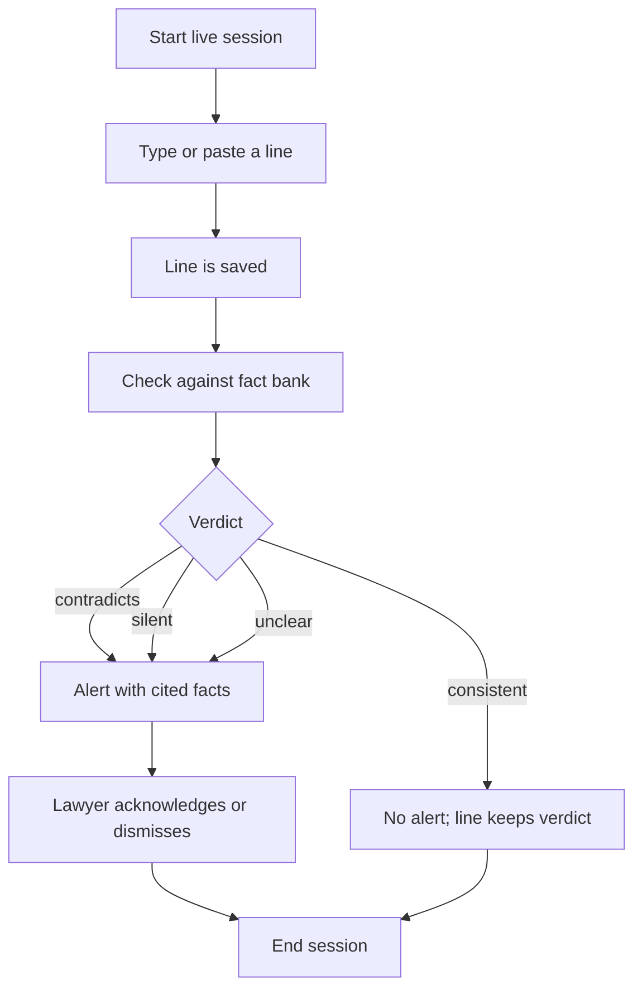

# User journeys

These are the four paths that matter most. They assume the server is reachable
and the user has a firm account.

## First run: operator creates the firm

## Invited member

## Matter review

Each step keeps the source one click away: fact to document page, answer to
cited fact, contradiction to both facts.

## Live hearing check

## Roles and visibility

- **Owner/admin**: firm settings, domains, members, invitations, API keys.
- **Lawyer**: matters they can access, evidence review, outputs, live review.
- **Paralegal**: upload, chronology, live transcription; review actions depend
  on permissions.
- **API key**: explicit scopes; read-only unless a write scope is granted.

The client does not invent permissions. Hiding an action is a convenience;
the server still checks the permission on every request, and the client must
never treat a hidden button as authorization.
