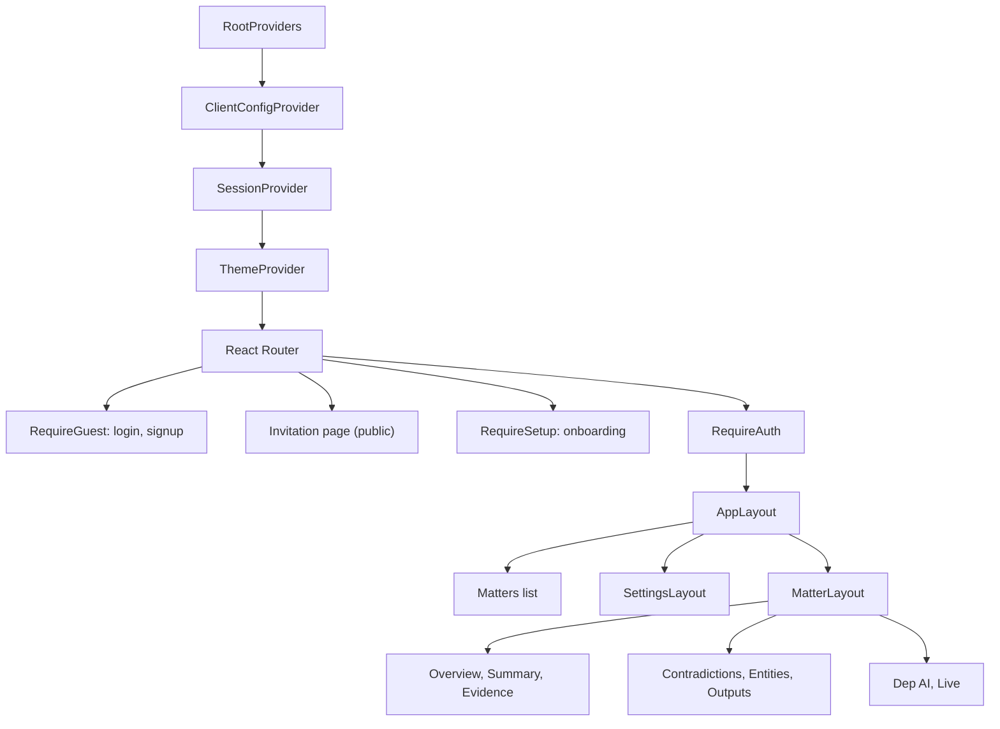
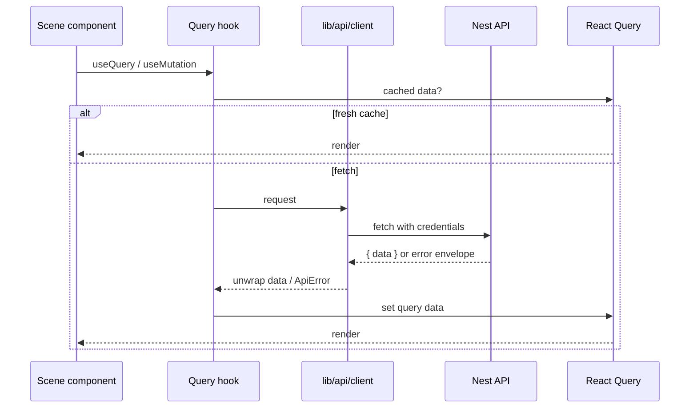

# Frontend architecture

The app is a React Router application with four provider layers. Route guards
and layouts read one server config, one session, and one query cache.

## Providers

| Provider | Responsibility |
| --- | --- |
| `ClientConfigProvider` | Fetches `/api/v1/tenant`, derives feature flags, blocks on failure with retry. |
| `SessionProvider` | Loads `/api/v1/me`, exposes the actor, handles sign-out. |
| `ThemeProvider` | Applies light/dark/system before paint and stores the choice per browser. |
| React Query | Server state cache keyed in `src/lib/query/keys.ts`. |

## API data flow

`src/generated` is Orval output from the server OpenAPI document. Hooks call
generated endpoint functions; they do not hand-write URLs. After a server
contract change, run `pnpm generate:api` and fix types rather than casting.

## Routing rules

- `/login` and `/signup` are guest-only.
- `/setup` is for a signed-in user on an unconfigured host.
- `/invitations/:token` is public so a new user can accept before signing in.
- Everything under `/matters`, `/settings`, `/notifications`, and `/help`
  requires a session.
- Matter navigation is capped at seven top-level sections; Evidence and
  Analysis group their children.

## Error handling

`ApiError` distinguishes network failures, HTTP status, stable server code,
details, and request id. Route-level errors render `RouteErrorPage`; `403`,
`404`, tenant-not-found, and maintenance have dedicated screens. A failed
tenant lookup never falls through to an unauthenticated workspace.

## Related

- `src/index.tsx` - provider tree and routes
- `src/lib/config/client-config.tsx` - flags
- `src/lib/auth` - session, guards, auth calls
- `src/lib/query` - client and keys
