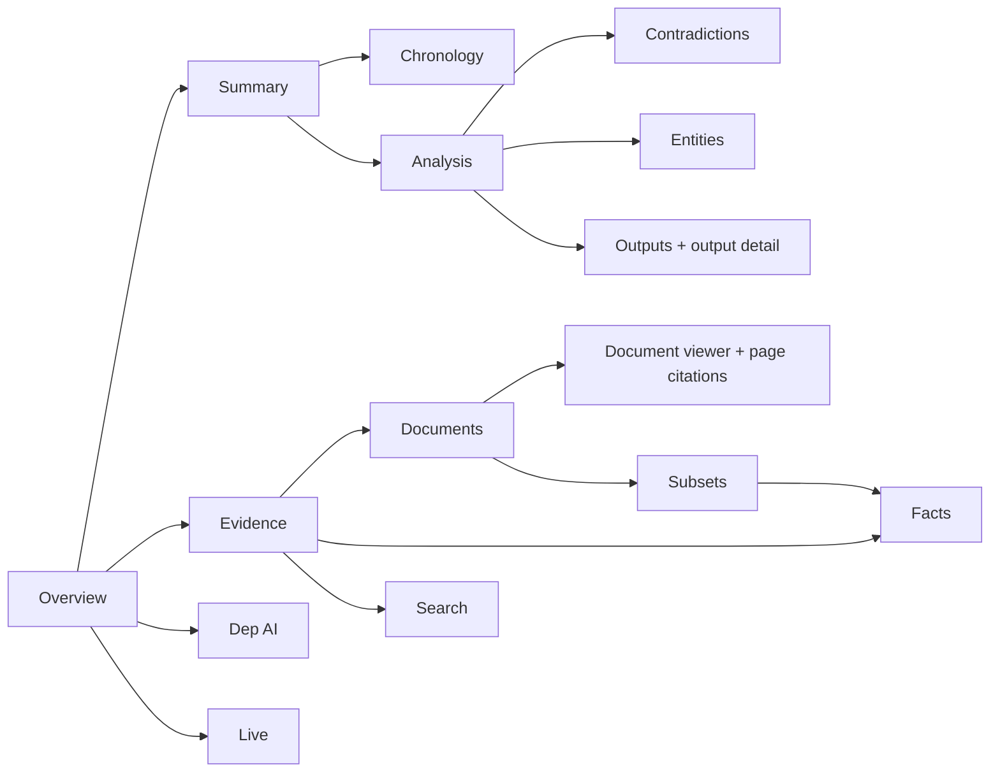
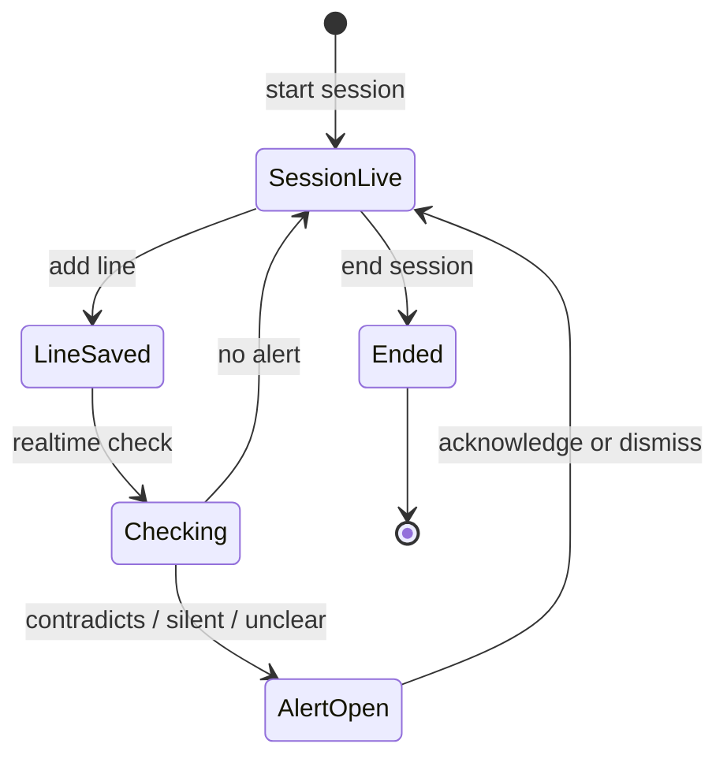

# Matter workspace

A matter is the container for evidence and work product. The workspace is
organized so a reviewer can go from a claim to its source in two clicks.

## Evidence

- **Documents** lists uploads with processing state. Selecting a document opens
  the viewer; the fact panel shows facts sourced from that document.
- **Facts** is the fact bank. Candidate facts can be confirmed or rejected;
  each fact opens its source document and page.
- **Search** returns facts and passages with the same citation fields.
- **Subsets** scope later analysis. A subset workspace narrows documents before
  facts, chronology, and questions are evaluated.

## Summary

Summary is a derived view: issues, confirmed facts, conflict counts, and gaps.
It does not invent a narrative when the record is thin. Every item links back
to the fact or contradiction that produced it, and empty sections say so.

## Contradictions

The list shows severity, status, and evidence count. Detail compares the two
sides: fact text, source document, page, and quote. Review actions change
status; severity can be adjusted without changing the underlying facts. A
"compare evidence" dialog keeps both sides on screen.

## Entities

The list groups mentions by canonical name and aliases. Detail shows aliases,
mention counts, related facts, and relations. Creating an alias never rewrites
a document.

## Outputs

Outputs are read surfaces. The list shows drafts for the matter; detail shows
the current version and its cited sources. Opening a source follows the same
document/fact route as evidence review.

## Document viewer

The viewer renders pages and exposes a citation rail. Selecting a fact scrolls
to its page and highlights the quote. If a document has no text layer, the
viewer still shows pages and labels OCR/review state instead of pretending the
text is searchable.

## Dep AI and Live

- **Dep AI** stores conversations per matter. Each answer shows citations,
  evidence score, warnings, and an explicit insufficient-evidence state.
- **Live** starts a session, accepts transcript lines, and shows alerts only
  for contradictory, silent, or unclear verdicts. Alerts link to the facts they
  used; the operator acknowledges or dismisses them.

