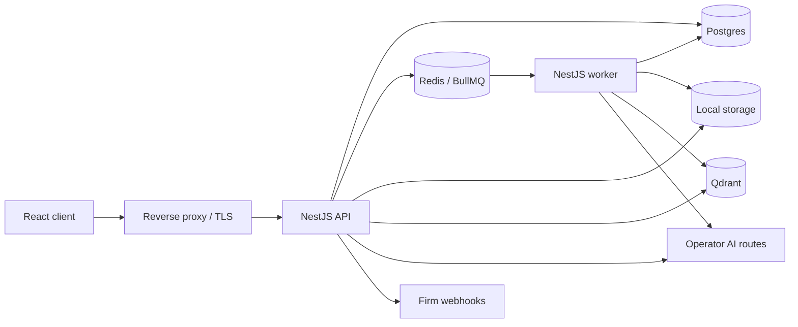
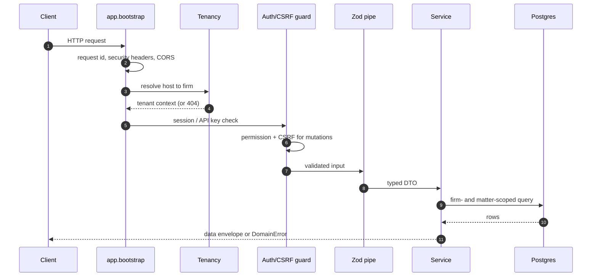
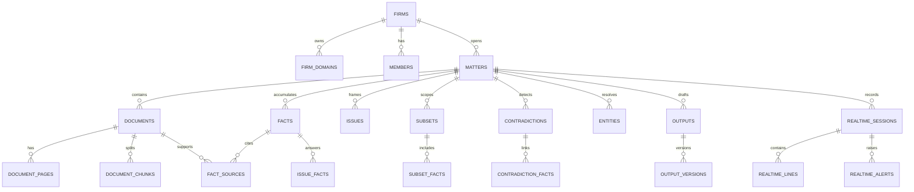

# Architecture

Depose is a modular NestJS monolith with two process roles that share one
codebase:

- **API** (`src/main.ts`): HTTP, authentication, tenancy, reads, and job
  enqueueing. Horizontal replicas run with `WORKER_ENABLED=false`.
- **Worker** (`src/worker.main.ts`): BullMQ consumers for OCR, fact
  extraction, document embedding, webhooks, and retries.

Both roles import the same `AppModule` so DI, permissions, and storage behave
identically. Splitting the process is an operational choice, not a code fork.

## Runtime shape

The API and worker can run in one container for small self-hosted installs;
the compose stack runs them separately so uploads never compete with request
latency.

## Modules

| Area | Modules | Responsibility |
| --- | --- | --- |
| Platform | `tenancy`, `auth`, `identity`, `firms`, `access-control`, `api-keys`, `audit`, `settings` | Host tenancy, sessions/SSO, members, roles, API keys, audit trail. |
| Matter core | `matters`, `documents`, `subsets`, `facts`, `chronology` | Matter record, document storage/OCR, scoped evidence sets, confirmed facts, dates. |
| Intelligence | `search`, `intelligence`, `inconsistencies`, `entities`, `issues`, `relevance`, `summary-theme`, `outputs` | Retrieval, grounded answers, conflicts, entity resolution, issue framing, drafts. |
| AI | `ai` (`embeding`, `ocr`), `vector` | Provider registry, embeddings, OCR, Qdrant indexing. |
| Realtime | `realtime` | Live sessions, transcript lines, alerts. |
| Jobs and integration | `jobs`, `webhooks`, `notifications`, `mcp-registry`, `mcp-server`, `onboarding` | Queue registration, delivery, read-only MCP, first-run setup. |

Feature modules follow the same shape: `*.controller.ts` for HTTP and
OpenAPI, `*.service.ts` for behaviour, `*.dto.ts` for Zod input schemas,
`*.response.ts` for Swagger response classes, and a module that exports only
what other modules consume.

## Request pipeline

Every read and write goes through a firm scope. A route that accepts
`:matterId` also checks that the matter belongs to the firm before the service
queries it. Errors are converted by `common/exception.filter.ts` into one
envelope with `statusCode`, `code`, `message`, `details`, and `requestId`.

## Data ownership

Facts are the unit of truth. Documents support facts; they never replace them.
AI answers, summaries, drafts, and live alerts all reference fact ids so a
reviewer can reach the source.

## AI boundary

Model calls are instance-owned and server-side. The browser never receives a
provider key. The three route families are deliberately separate:

- **AI route** - conversation, drafting, and reasoning over retrieved facts.
- **Extraction route** - typed fact extraction from documents.
- **Decision route** - System One-style contradictions and relevance checks.

This separation lets an operator use a local model for prose and a calibrated
decision model for calls that need a typed verdict.

## Related docs

- [`docs/01-request-lifecycle.md`](docs/01-request-lifecycle.md)
- [`docs/03-data-model.md`](docs/03-data-model.md)
- [`docs/04-ingestion.md`](docs/04-ingestion.md)
- [`docs/05-retrieval.md`](docs/05-retrieval.md)
- [`docs/09-background-jobs.md`](docs/09-background-jobs.md)
