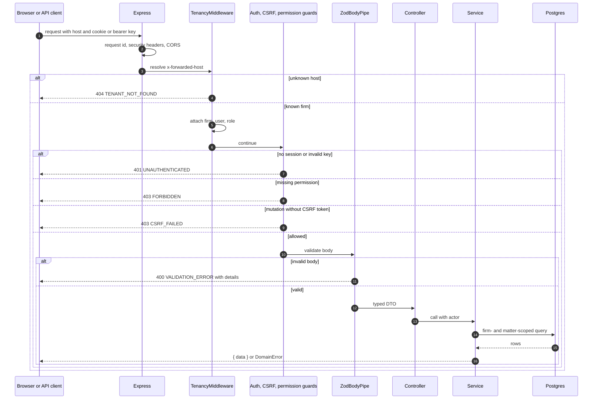

# Request lifecycle

Every API request follows the same path. Uploads are the only exception: they
are parsed as raw bodies up to 100 MB before the JSON parser runs.

## Details that matter

- The host is the tenant key. `TRUST_PROXY=true` makes Express read
  `x-forwarded-host` from the trusted proxy; direct client headers are ignored
  otherwise.
- `/api/auth/*` is handled by Better Auth before Nest routing and has its own
  limiter. Auth responses are not wrapped in the `{ data }` envelope.
- `/api/v1/*` JSON is limited to 1 MB. The document upload route accepts raw
  bodies up to 100 MB with an allowlisted MIME type.
- Controllers never read `request.body` directly. `ZodBodyPipe` produces the
  DTO and rejects unknown or malformed fields.
- The actor (`firmId`, `userId`, role, permissions) comes from the session or
  API key. A client-supplied `firmId` is never trusted.
- `DomainError` carries a stable code, an HTTP status, and optional details.
  `common/exception.filter.ts` adds `requestId`; clients should log that id.
- Response bodies for API routes are `{ "data": ... }`. Lists add pagination
  metadata through the shared pagination helper.

## Where to change it

| Concern | File |
| --- | --- |
| Middleware order, body limits, CORS | `src/app.bootstrap.ts` |
| Request id and security headers | `src/common/request-id.middleware.ts`, `security-headers.middleware.ts` |
| Tenant resolution | `src/modules/tenancy` |
| Session and API-key authentication | `src/modules/auth`, `src/modules/api-keys` |
| CSRF and permissions | `src/common/csrf.guard.ts`, `src/modules/access-control` |
| Error envelope | `src/common/domain-error.ts`, `exception.filter.ts` |
