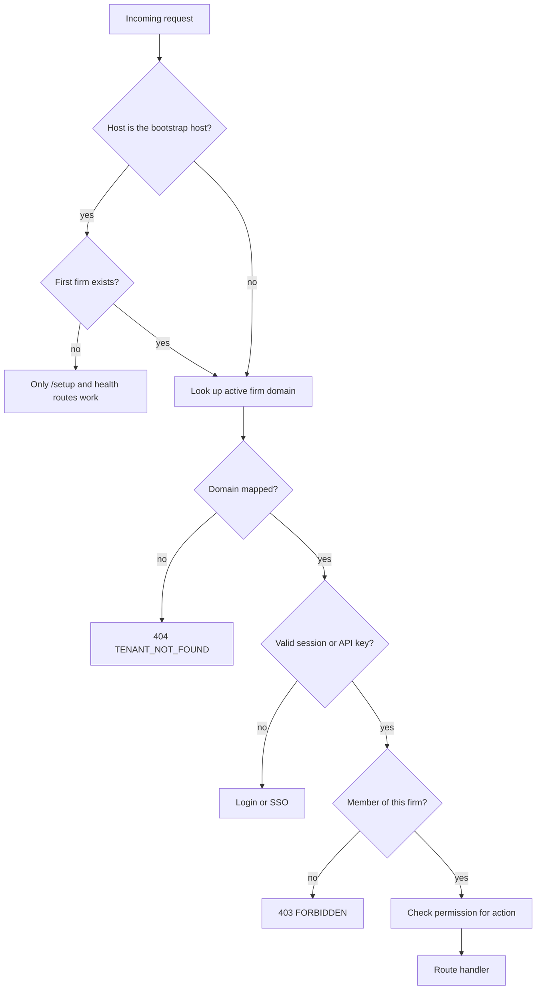
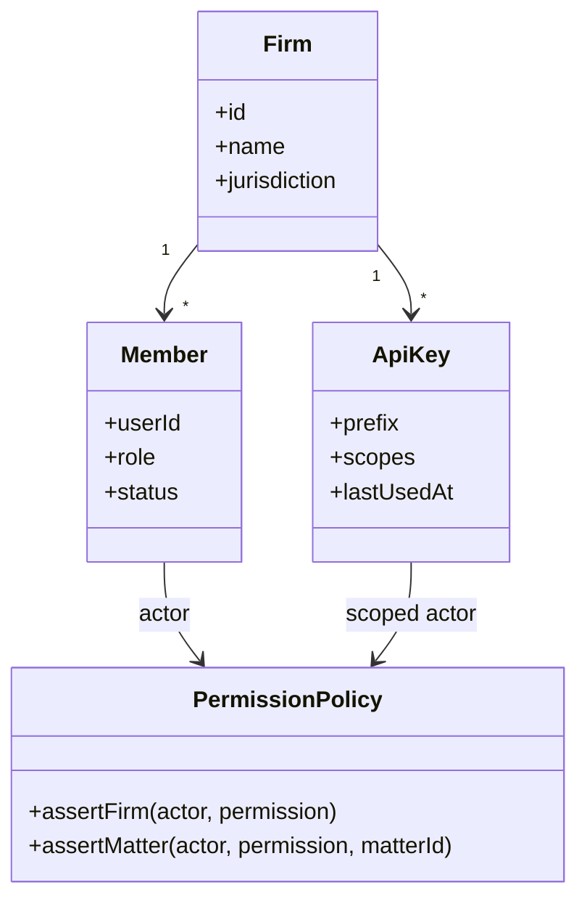

# Tenancy and authentication

Depose is single-tenant per host. One deployment can serve many firms, but a
request is always resolved to exactly one firm by its hostname.

## Signup paths

| Mode | Behaviour |
| --- | --- |
| Self-signup enabled | `POST /api/auth/sign-up/email` creates an account on the resolved firm. |
| Self-signup disabled | The signup page shows a closed state and points to a firm admin. |
| SSO enabled, password login allowed | Login offers both. The user enters an email, then continues with SSO. |
| `AUTH_FORCE_SSO=true` | Password login and self-signup are hidden; SSO is the only entry. |
| Email verification required | The account exists but cannot sign in until the mail link is used. If SMTP is not configured, the API exposes that state to the UI. |
| Invitation | `/invitations/:token` shows the firm and inviter, accepts the invitation, and creates the member row. |

Admin approval (`AUTH_REQUIRE_ADMIN_APPROVAL`) keeps a new account pending
until a firm admin activates it. The tenant response publishes this state so
the client can explain it instead of showing a generic failure.

## Roles and permissions

Roles are firm-scoped. Permissions are checked in the access-control module,
not inferred from the role in each controller. API keys are separate: a key
belongs to a firm, carries explicit scopes, is stored as a SHA-256 digest, and
is read-only unless a scope is granted.

## First-run setup

`GET /api/v1/tenant` reports `requiresSetup` and `isBootstrapHost`. The client
routes a signed-in user to `/setup` when required. `POST /api/v1/onboarding`
creates the firm, domain, and first admin; after that the bootstrap host only
serves setup when no firm exists.

## Related

- `src/modules/tenancy` - host resolution, tenant response
- `src/modules/auth` - Better Auth wiring, SSO, session guard
- `src/modules/identity` - members, invitations, profile
- `src/modules/access-control` - permissions and roles
- `src/modules/api-keys` - scoped API keys
