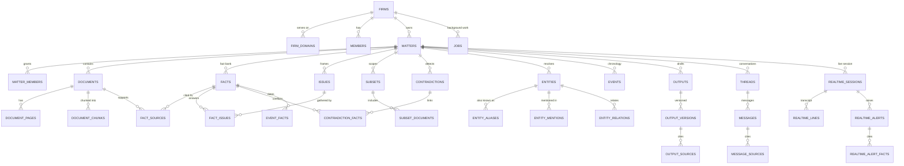

# Data model

Postgres is the system of record. Drizzle schema files live in
`src/infrastructure/database/schema`. The diagram shows the tables that carry
the legal workflow; audit, usage, auth, and MCP tables are omitted for space.

## Invariants

- `facts` always belong to a matter and a firm. A fact without at least one
  `fact_sources` row is not usable evidence.
- `fact_sources` points at a document and page (or a transcript segment).
  Deleting a document soft-deletes it; history stays readable.
- `supports` and conflict links are many-to-many. A contradiction names both
  sides through `contradiction_facts`.
- `subsets` narrow retrieval. A subset document/fact set is applied before
  lexical or vector ranking, never after generation.
- Output versions are immutable. Sources are stored per version so an old
  draft still explains itself even after facts change. The current read API
  returns the current version and its sources.
- `messages` keep `answer`, `citations`, `evidence_score`,
  `insufficient_evidence`, and `tool_calls` so a conversation can be audited.

## Candidate versus confirmed

The fact bank distinguishes model output from lawyer-accepted truth:
`facts.status` moves through candidate, confirmed, rejected. Contradictions
have their own review state. The UI and API must not present a candidate fact
as settled, and summaries use confirmed facts only.

## Migrations

Generate with `pnpm db:generate`, apply with `pnpm db:migrate`. The production
stack runs `node dist/migrate.js` once before the API and worker start.
