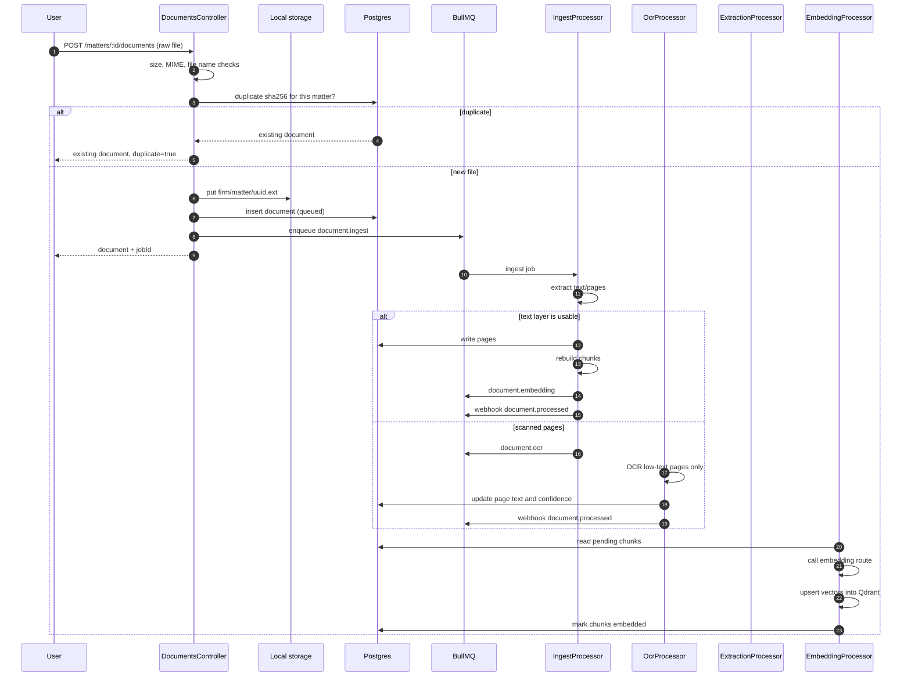
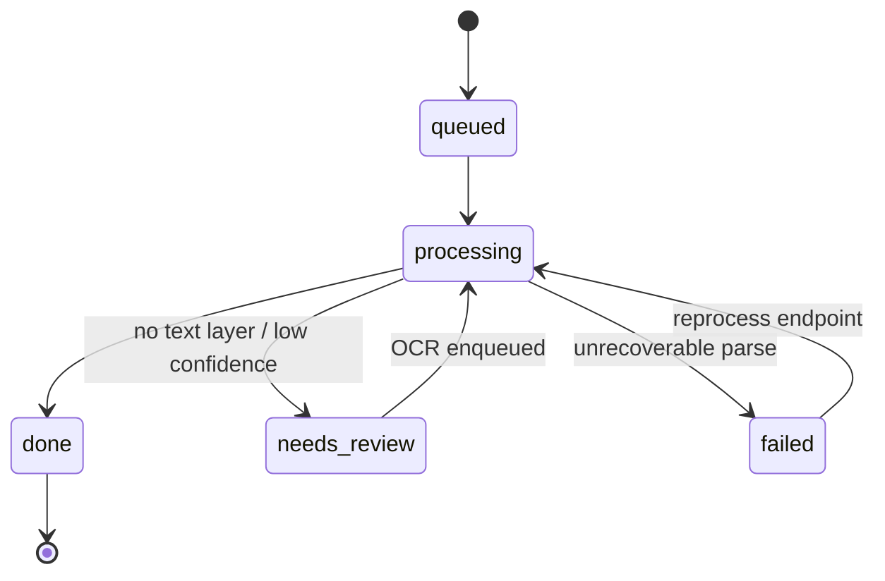

# Document ingestion

Upload is asynchronous. The HTTP request stores the file and enqueues work;
nothing is parsed inline.

## Status model

`needs_review` is not an error. It means the document is stored but the text
layer is missing or too short; the OCR job is the next step. If no OCR provider
is configured, the document stays readable as an image/PDF and the reason is
returned.

## Extraction

Fact extraction is a separate queue (`fact.extraction`) and a separate route
(`EXTRACTION_PROVIDER`). It writes candidate facts plus `fact_sources`, never
confirmed facts. A reviewer promotes or rejects them. Re-running extraction
records a new `extraction_runs` row; facts keep their version history.

Chunking is deterministic: same document text produces the same chunk
boundaries, and `chunkVersion` is part of the chunk identity. Embedding jobs
only process chunks that are not yet embedded, so a retry does not duplicate
points.

## Limits and safety

- 100 MB per file, enumerated MIME types, sanitized file name.
- Content-addressed duplicate detection per matter.
- Local storage only; `STORAGE_TYPE` rejects anything else.
- OCR reads only pages whose `charCount` is below `OCR_MIN_TEXT_CHARS`.
- Every job is tracked in `jobs` with progress and a terminal state.
