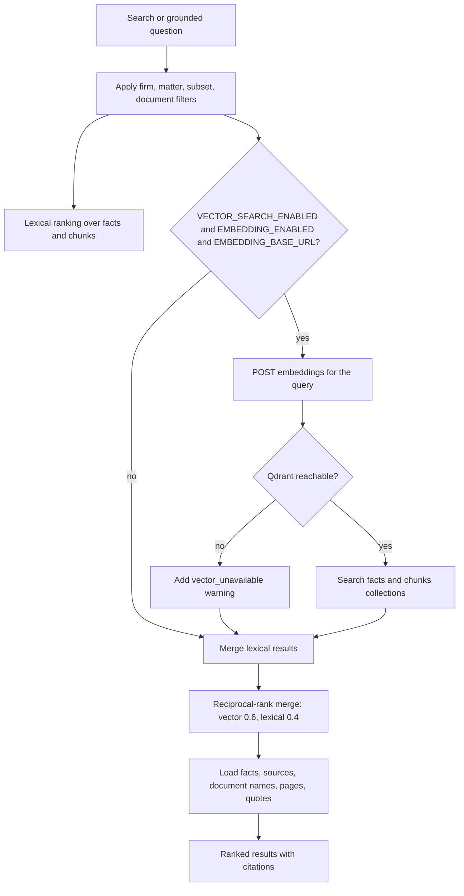
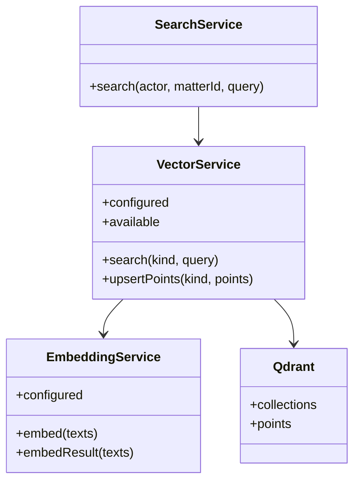

# Retrieval: lexical search, embeddings, and Qdrant

Retrieval answers "which confirmed facts and document passages are relevant?"
The result always carries source ids. Generation happens after retrieval, not
before.

## Path selection



Lexical search always runs. The vector path is an additive signal, which is
why a Qdrant outage degrades quality instead of failing the request.

## Embedding versus vector store

An embedding model converts text into vectors. Qdrant stores those vectors and
finds nearest neighbours. They are separate settings:

| Configuration | Result |
| --- | --- |
| `EMBEDDING_ENABLED=true`, `EMBEDDING_BASE_URL` set, `QDRANT_URL` set | Hybrid retrieval; embeddings are stored and queried. |
| `EMBEDDING_ENABLED=false` | No model call, no vectors, no Qdrant query; lexical retrieval only. |
| `EMBEDDING_ENABLED=true` but no `EMBEDDING_BASE_URL` | Same as off; the route is incomplete. |
| `VECTOR_SEARCH_ENABLED=false` | Vector path disabled everywhere, including indexing jobs. |
| Qdrant configured without an embedding route | Qdrant is reachable but unused for retrieval; there is no text-to-vector step. |

There is deliberately no "Qdrant-only, no encoder" mode: a vector database
cannot search raw text. If vectors are produced by an external pipeline in the
future, that pipeline must write them through the embedding/index contract.

## Embedding route contract

`EmbeddingService` calls an OpenAI-compatible endpoint:

```http
POST {EMBEDDING_BASE_URL}/embeddings
Authorization: Bearer {EMBEDDING_API_KEY}
{ "model": "...", "input": ["text", "..."] }
```

The response must return one `data[].embedding` per input. Batches are 32
texts, truncated to 8,000 characters. `EMBEDDING_DIMENSION` must match the
model and the Qdrant collection; changing it requires a new collection prefix
or a reindex.



## Subsets and filters

A subset narrows the document ids before ranking. The same scope is applied to
lexical facts, lexical chunks, and vector payload filters, so a vector hit can
never escape the selected subset. Document-scoped queries work the same way.

`includeUnsupported` and `status=proposed|unsupported` change which fact states
are eligible. Normal searches exclude unsupported facts.

## Failure behaviour

- Embedding route non-2xx: the search continues lexically and reports a
  warning; the embedding job records `EMBEDDING_UNAVAILABLE`.
- Qdrant non-2xx or timeout: `VectorService` enters a short degraded window and
  reports `vector_unavailable`; retries are not attempted inline.
- Dimension mismatch: Qdrant rejects the upsert; the job fails visibly instead
  of writing mixed-dimension points.
