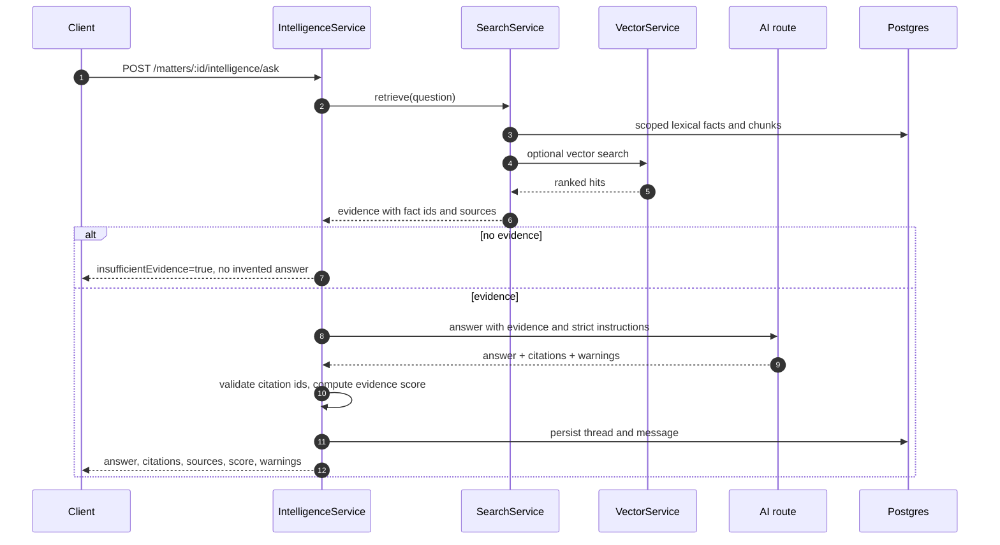
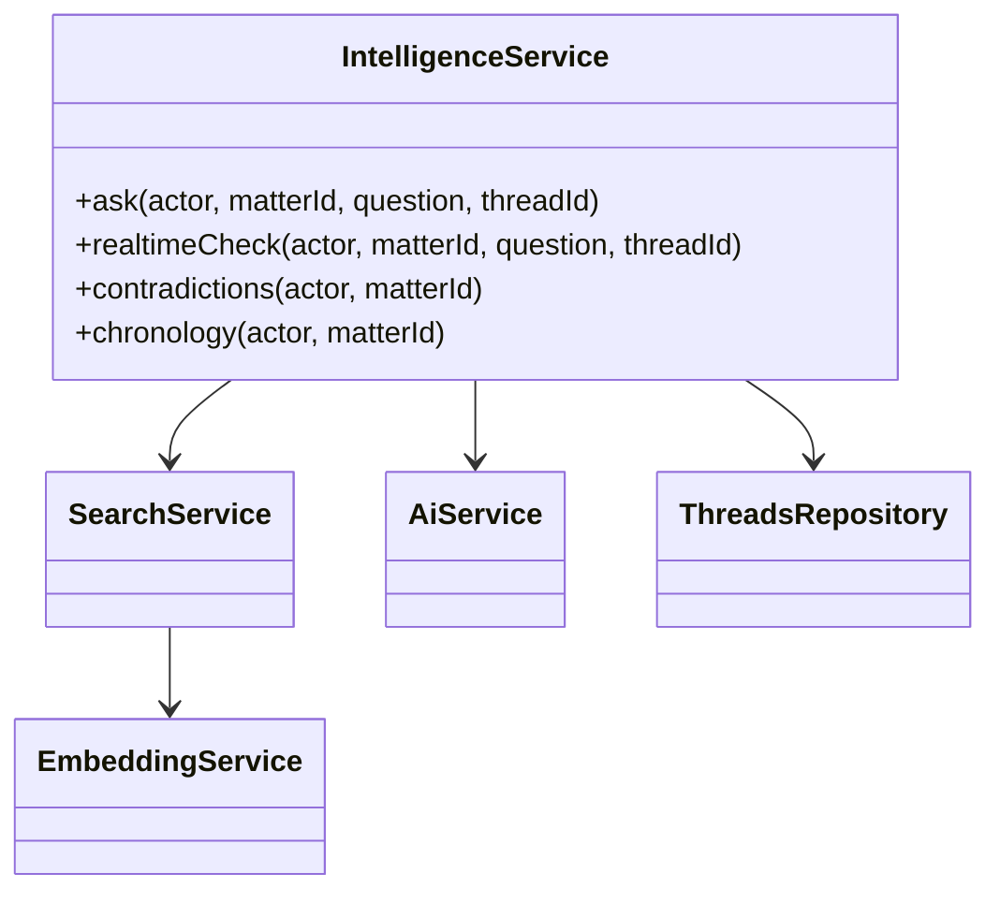

# Grounded intelligence

`IntelligenceService` is the only path from a legal question to a model answer.
It retrieves evidence first, then asks the model to answer using only that
evidence, and returns structured citations.

## Evidence rules

- The model receives only retrieved facts and passages, each with an id.
- A citation that does not match an evidence id is dropped; it is not shown as
  a source.
- `evidenceScore` reflects coverage of the question by retrieved evidence, not
  model confidence.
- `insufficientEvidence` is a first-class result. The prompt must not turn a
  silent record into an answer.
- `warnings` carries degraded conditions such as `vector_unavailable`, a
  missing model, or a truncated context.
- The full message record (`answer`, `citations`, `sources`, `toolCalls`,
  `evidenceScore`, `insufficientEvidence`) is stored for audit and replay.

## Two callers

| Caller | Endpoint | Behaviour |
| --- | --- | --- |
| Chat | `POST /matters/:id/ai/threads/:threadId/messages` and ask routes | Full answer, persisted in a thread. |
| Live check | `POST /matters/:id/realtime/sessions/:sessionId/lines` | Short verdict-oriented answer used to raise alerts. |

Both share the same retrieval and citation validation. The live path adds a
`verdict` field (`consistent`, `contradicts`, `silent`, `unclear`) and only
raises an alert for the last three.

## Configuration boundaries

- Chat and drafting use the AI route (`AI_PROVIDER`, `AI_BASE_URL`, etc.).
- Fact extraction uses the extraction route.
- Contradiction decisions use the decision route.

Keeping them separate prevents a prose model from silently becoming the
authority on a typed legal decision.

## Related files

- `src/modules/intelligence/intelligence.service.ts`
- `src/modules/search/search.service.ts`
- `src/modules/ai` - model registry and conversation services
- `src/modules/outputs` - drafts built from the same evidence model
