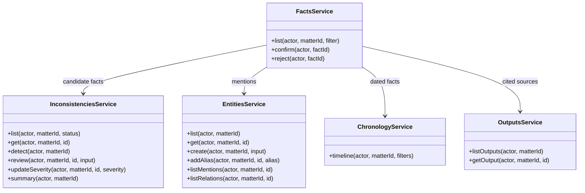

# Analysis features

Contradictions, entities, chronology, summary, and outputs are separate
read/write surfaces over the same fact bank. None of them owns a second copy of
the evidence.

## Contradictions

Detection is a typed decision per fact pair, not free-form prose. A
contradiction stores kind, severity, status, confidence, and links to the
facts on both sides. Review moves it through candidate, open, confirmed,
dismissed, or stale. Only confirmed contradictions should appear in a legal
summary.

- List includes an evidence count so the UI can show how much supports a flag.
- Detail returns the linked facts plus their source documents and pages.
- Changing the underlying facts can mark a contradiction stale rather than
  silently keeping a decision that no longer matches the record.

## Entities

Entities are canonical people, organizations, locations, and things. Aliases
are explicit, mentions point to facts/documents, and relations are typed.
Creating or merging an entity never rewrites source text; it only changes how
mentions are grouped. A resolved entity keeps its alias list and mention count
in the list response.

## Chronology

The timeline selects dated facts and events, applies the same subset/document
scope as search, and returns normalized dates plus the originating fact. A
missing date is shown as missing, not inferred from prose.

## Summary

Summary is derived, not generated into a separate truth store. It combines
issues, confirmed facts, conflict counts, and coverage gaps. A summary that
cites a fact must be able to open that fact and its source document.

## Outputs

An output is a draft such as a chronology narrative, memo, or issue analysis.
The read API returns the output's current version and the sources attached to
that version. Stored versions are immutable and each has its own source list,
so reading an old version keeps the evidence it was written against even if
facts were edited later. This package exposes the read side only; there is no
firm-facing output write endpoint.

## Related files

- `src/modules/inconsistencies`
- `src/modules/entities`
- `src/modules/chronology`
- `src/modules/outputs`
- `src/modules/facts`
