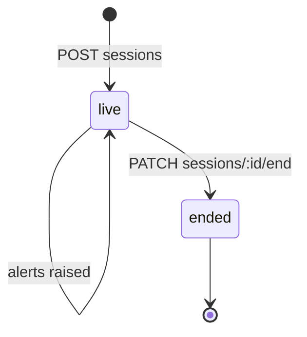
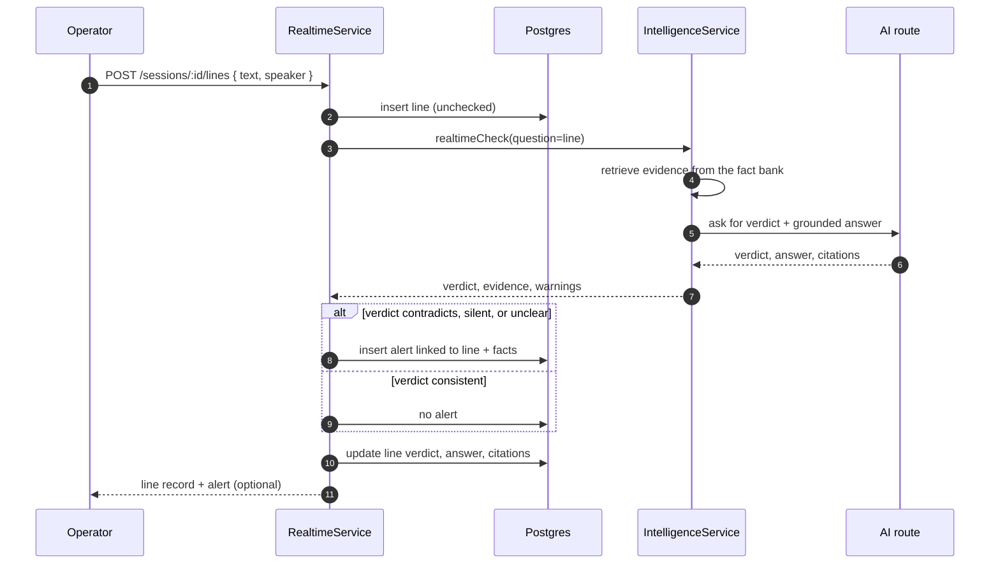

# Live transcript checking

Live mode records a hearing or interview line by line and checks each line
against the fact bank. It is designed for a human operator, not an autonomous
courtroom listener: an alert is a prompt to look, never a conclusion.

## Session lifecycle

A session stores its matter, title, start/end time, and operator. Lines and
alerts are always scoped to a session and a matter; ending a session does not
delete the record.

## Checking a line

The line is persisted before the model call. If the AI route fails, the line
still exists and its `checkStatus` records the failure; the operator can retry
without losing the transcript. Alerts are only raised for `contradicts`,
`silent`, and `unclear`; a `consistent` line is still stored with its verdict.

## Alerts

An alert has a severity, a status (open, acknowledged, dismissed), a linked
line, and the facts it used. `PATCH /alerts/:alertId` is the review action.
Citation ids are validated against the retrieved evidence before the alert is
created, so an alert cannot point at a fact the system did not actually use.

## Permissions

`realtime.start`, `realtime.send`, `realtime.review`, and `realtime.end` are
separate permissions. A paralegal can transcribe without being allowed to
close alerts; a supervising lawyer can review without typing every line.

## Related files

- `src/modules/realtime/realtime.service.ts`
- `src/modules/realtime/realtime.controller.ts`
- `src/modules/intelligence/intelligence.service.ts` (`realtimeCheck`)
