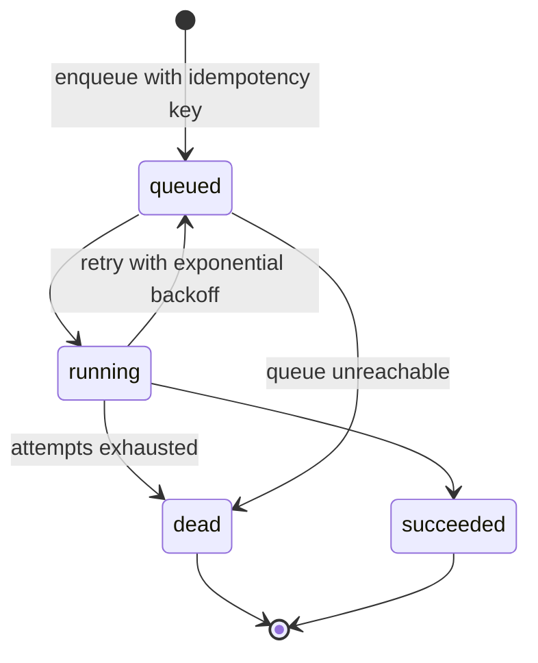

# Background jobs

BullMQ carries work that must not block a request. The `jobs` table is the
durable record: the queue can be rebuilt from it, and the API reports progress
from it, not from Redis internals.

## Queues

| Queue | Producer | Work |
| --- | --- | --- |
| `document.ingest` | Document upload, reprocess | Extract text, write pages, chunk, enqueue embedding |
| `document.ocr` | Ingest when pages lack a text layer | OCR only low-text pages, update page text |
| `fact.extraction` | Extraction request | Produce candidate facts and sources |
| `document.embedding` | Ingest, manual reindex | Embed pending chunks and upsert Qdrant points |
| `webhook.delivery` | Feature events | Signed HTTP delivery to firm endpoints |

Default attempts: 3 for ingest/OCR/embedding, 2 for extraction. Backoff is
exponential starting at 5 seconds. `RETRY_DELAYS_MS` documents the intended
schedule for handlers that need a manual retry policy.

## Idempotency

`enqueue` is keyed by `(firmId, jobKey, idempotencyKey)`. A duplicate request
returns the existing job; a succeeded job is not re-run. A dead job refuses a
second enqueue with the same key and requires a new key after review. The
unique index is the arbiter, not the pre-check.

Job payloads contain ids, not document bytes. The worker reloads the row, so a
retry sees the current state rather than a stale snapshot.

## Progress and failure

Each processor implements the same tracked lifecycle (`start`, `progress`,
`finish`, `recordFailure`) and writes `running`, progress percentage/stage,
result, and `finishedAt` to the `jobs` row. A failure records `errorCode` and
`errorMessage`; the original error is rethrown so BullMQ applies its retry
policy. Non-retryable failures (such as "no pages") are marked dead
immediately with `retryable=false`.

## Why the API and worker can split

`JobsModule` exports `BullModule` and `JobsService`. Both processes import the
same module; `WORKER_ENABLED=false` stops the API from registering consumers
while still allowing it to enqueue. The worker is started with
`node dist/worker.main.js`.

## Related files

- `src/modules/jobs/queue.constants.ts`
- `src/modules/jobs/jobs.service.ts`
- `src/modules/jobs/jobs.module.ts`
- `src/modules/documents/ingest.processor.ts`
- `src/modules/ai/{ocr,embeding,extractions}/*.processor.ts`
