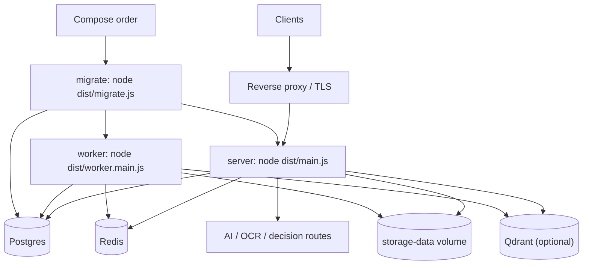

# Deployment and operations

A production install is a reverse proxy, one or more API processes, one worker,
Postgres, Redis, optional Qdrant, and a shared storage volume.

## Startup order

1. Postgres and Redis become healthy.
2. `migrate` applies Drizzle migrations once.
3. API and worker start. The worker sets `WORKER_ENABLED=true`; API replicas
   set it to `false` when a dedicated worker exists.

A single-process install may run with `WORKER_ENABLED=true` and no separate
worker, but document processing then competes with HTTP traffic.

## Readiness

- `GET /api/health` is liveness; it does not touch dependencies.
- `GET /api/health/ready` returns 503 when Postgres or Redis is unavailable.
- Qdrant and external providers are optional. Their absence degrades search or
  AI features; it must not make the API unready.

## Storage

`STORAGE_TYPE=local` is the only supported mode. Files live under
`STORAGE_LOCAL_PATH` and must be on a volume shared by the API and worker.
Postgres stores metadata and source quotes; it does not store document bytes.
Back up the volume and the database together.

## Tenancy and TLS

- Point wildcard DNS at the proxy and set `BASE_DOMAIN`.
- Set `TRUST_PROXY=true` so the API reads the forwarded host, not the internal
  socket address.
- `TLS_MODE=external` terminates TLS at the proxy; `files` loads a certificate
  in the process; `cloudflare` is for a Cloudflare-fronted host.
- Custom domains are verified per firm and served by the same API.

## Security defaults

- Security headers, request ids, and CORS allowlist are applied in
  `app.bootstrap.ts`.
- JSON bodies are capped at 1 MB; only upload routes accept 100 MB.
- Auth routes have a stricter limiter than the general API.
- Admin-supplied outbound URLs are checked by `common/outbound-url.ts`.
  `ALLOW_PRIVATE_OUTBOUND_URLS=auto` blocks private targets in production.
- Webhook secrets are encrypted with `WEBHOOK_ENCRYPTION_KEY`; deliveries are
  HMAC-signed.

## Related

- `packages/docker/README.md` - compose stacks and upgrade steps
- `src/main.ts`, `src/worker.main.ts`, `src/migrate.ts`
- `src/config/app.config.ts`
