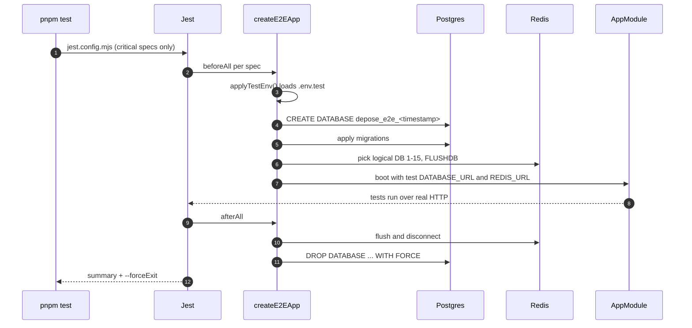
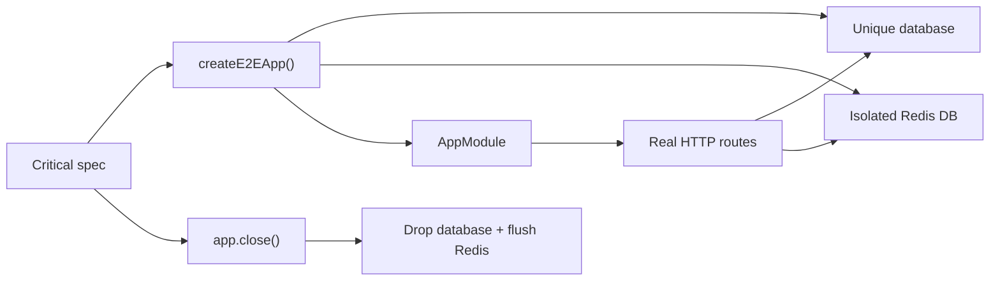

# Testing

Depose tests only the critical legal and security paths. The suite runs on
Jest, uses the development Postgres and Redis, and forces the process to exit
when the run finishes.



## What runs

`jest.config.mjs` lists the only specs in the default suite:

| Spec | Critical path |
| --- | --- |
| `auth.e2e.spec.ts` | Signup, sign-in, session cookie, sign-out, forged cookie. |
| `tenancy.e2e.spec.ts` | Host resolution, cross-firm isolation, IDOR regression. |
| `ingest.e2e.spec.ts` | Upload, duplicate detection, jobs, extraction wiring. |
| `ai.e2e.spec.ts` | Grounded answer, citation mapping, no provider leak. |
| `inconsistencies.e2e.spec.ts` | Decision route, dedup, severity, consistent pairs. |
| `jobs.e2e.spec.ts` | Idempotency, retry metadata, dead letters. |
| `production-hardening.e2e.spec.ts` | SSRF policy, headers, readiness, webhook secrets. |

Other test files are not part of the default suite. Add a file to `testMatch`
only when it covers a critical path; do not grow the suite for every endpoint.

## Why there are no containers

A container per spec pays image lookup, boot, and migration cost on every file.
On Windows that dominates the run and can leave the process without a clean
exit. The suite uses the development stack instead:

- Each spec file creates its own `depose_e2e_*` database and drops it after.
- Each Jest process takes a Redis logical database between 1 and 15 and flushes
  only that database. Development data in database 0 is untouched.
- Stale test databases older than six hours are removed at the next setup.

## Configuration

Copy `.env.test.example` to `.env.test` if the defaults do not match:

| Variable | Meaning |
| --- | --- |
| `TEST_DATABASE_ADMIN_URL` | Server with a role allowed to create databases. |
| `TEST_DATABASE_URL` | Optional existing database; used as-is and never dropped. |
| `REDIS_URL` | Base Redis URL; the logical index is replaced per process. |
| `TEST_REDIS_URL` | Exact Redis URL; used as-is and not flushed. |

Shell environment wins over `.env.test`. If no admin URL is set, the helper
reads `DATABASE_URL` from the server `.env` and connects to its `postgres`
database.

## Running

```sh
pnpm test                      # critical suite
pnpm test auth                 # one spec by name
pnpm test --testNamePattern="forged"  # one test by name
```

`scripts/test-jest.mjs` runs Jest with `--experimental-vm-modules` (the Nest
packages are ESM) and `--forceExit`. `--forceExit` is deliberate: BullMQ and
provider clients can leave handles open after `app.close()`, and a test run
must return without Ctrl+C.

## Rules for new tests

- Use `createE2EApp()` and close it in `afterAll()`.
- Do not mock Postgres. Create rows through the real handlers or test helpers.
- Keep model calls on the fake model server; never call a real provider.
- Run one spec file per critical path, not one per endpoint.
- If a new spec needs a queue processor, use the same app bootstrap.
- Import Jest APIs from `@jest/globals` (`describe`, `it`, `expect`,
  `beforeAll`, `afterAll`); do not rely on unimported globals.
- Use `jest-assert.ts` only for migrated assertions; new assertions should use
  Jest's `expect` directly.


