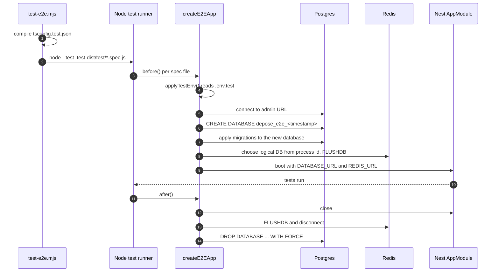
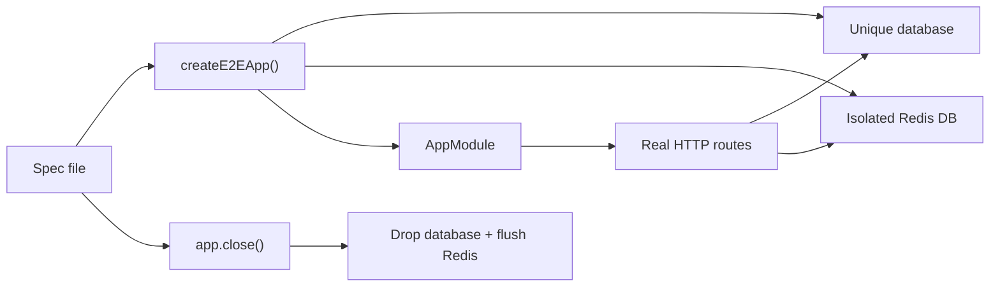

# Testing

The E2E suite uses the development Postgres and Redis. It does not start
containers, which is why a focused run finishes in seconds instead of minutes.



## Why no containers

A container per spec pays image lookup, Postgres boot, and migration cost on
every file. On Windows that dominates the run. A database on the existing
server gives the same isolation for a fraction of the time: every spec file
creates its own database, and parallel files never share rows.

Redis is isolated by logical database. Database 0 stays available for local
development; the suite uses a process-specific index between 1 and 15 and
flushes only that index.

## Configuration

Copy `.env.test.example` to `.env.test` when the defaults do not match:

```sh
cp .env.test.example .env.test
```

| Variable | Meaning |
| --- | --- |
| `TEST_DATABASE_ADMIN_URL` | Server plus a role allowed to create databases. The helper creates `depose_e2e_*` databases here. |
| `TEST_DATABASE_URL` | Optional existing database. Used as-is, migrated, never dropped. |
| `REDIS_URL` | Base Redis URL; the helper replaces the database index per process. |
| `TEST_REDIS_URL` | Exact Redis URL. Used as-is and not flushed. |

If `TEST_DATABASE_ADMIN_URL` is absent, the helper reads `DATABASE_URL` from
the server `.env` and connects to its `postgres` database. Shell environment
wins over `.env.test`.

## Running

```sh
pnpm test                                   # whole suite
pnpm test test/inconsistencies.e2e.spec.ts  # one file
pnpm test --test-name-pattern="maps statement"  # filter by test name
```

The runner forwards flags, compiles tests once, and uses
`--test-force-exit` so a stray provider or queue handle cannot keep the process
alive after the suite finishes.

## Rules for new tests

- Use `createE2EApp()` and close it in `after()`.
- Do not mock the database. Create rows through the real handlers or helpers.
- Do not depend on another spec file's data.
- Keep model calls on the fake model server; never call a real provider.
- A spec that needs a new queue processor still uses the same app bootstrap.
- If a test leaves a database behind after a hard kill, the next run removes
  `depose_e2e_*` databases older than six hours.


